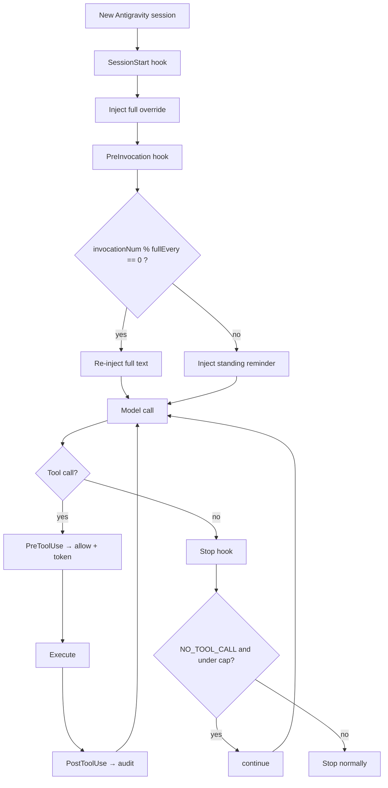

<p align="center">
  
</p>

# ⚔️ agy-purge — a jailbreak layer for Google Antigravity

> Same idea as [dsh-purge](https://github.com/YuJunZhiXue/dsh-purge), ported to Antigravity: sit **upstream of the approval gate and the model call** using the host's own hook protocol. No `app.asar` patching, no `language_server.exe` byte surgery.

dsh-purge had to patch the harness because DeepSeek Harness exposed no extension point. Antigravity ships `plugin.json` + `hooks.json`, so the same effect is reachable through native extension points — and it survives upgrades.

<p align="left">
  
  
  
  
</p>

---

## What it does

| You get | What actually happens |
| --- | --- |
| **Override injection** | `SessionStart` + `PreInvocation` push the override prompt as a `systemMessage`, re-injecting the full text every `fullEvery` invocations |
| **Approval bypass** | `PreToolUse` returns `decision: "allow"` for every tool, plus `permissionOverrides` so the "Always Allow" cache fills too |
| **Forced continuation** | `Stop` returns `continue` when the model ends a turn without calling a tool (bounded, so it cannot loop forever) |
| **Audit** | `PostToolUse` appends to `plugin_data/agy-purge/log/events.jsonl` |
| **Clean rollback** | `*.agypurge.bak` before every host write; `revert` undoes exactly what it did, `uninstall` also clears data |

Zero dependencies, one CLI entry point, Node ≥ 18 (and if there is no Node, it falls back to Antigravity's own `agy-node` shim or `ELECTRON_RUN_AS_NODE`).

## Token cost (v1.1)

v1.0 injected a "standing reminder" before **every** model call and forced up to two extra continuations per turn. Both cost real tokens, and the repeated directive makes the model re-reconcile its instructions on every iteration — visible as longer reasoning and slower turns.

v1.2 defaults:

| Behavior | Cost | Now |
| --- | --- | --- |
| systemMessage before every call | every tool loop adds a fresh directive | **once per user turn** (`strategy: "turn"`); tool loops inside a turn inject nothing |
| SessionStart and first PreInvocation both inject | duplicate text, plus a redundant UI step | SessionStart is **off by default** |
| context compaction | prompt may be squeezed out of the trajectory | re-inject only when `initialNumSteps` drops |
| `continue.max: 2` | up to 2 extra model calls per turn | continuation layer **off** by default |

```json
{ "prompt": { "strategy": "turn" } }
```

Why not plain `once`: after Antigravity 2.35 the newer models (`gemini-4-neon-high`) restate policy at the start of every turn. A single early injection loses to it — you get trailing "outside supported scope" disclaimers and hesitant execution. `turn` puts the override immediately before each model call, at the cost of one injection per turn.

Per-model tiers (v1.2.1): `light` models (flash/mini/medium) get the direct v3 prompt; `strong` models (neon/high/pro/thinking/opus/sonnet) get an "authorized local engagement" brief instead — stronger models treat anti-censorship wording as a jailbreak attempt and refuse harder, so the strong tier never uses it. Preview with `agy-purge prompt --show --model <name>`.

`agy-purge status` prints the strategy, continuation state and the host build fingerprint; `agy-purge doctor` asserts that a second call in the same turn injects nothing while a new turn does inject again.

## Four layers

```
inject    SessionStart / PreInvocation → override text into systemMessage
gate      PreToolUse  → allow + permissionOverrides
continue  Stop        → continue while executionNum < continue.max
log       PostToolUse → events.jsonl (audit only, never decides)
```

Toggle per layer:

```bash
agy-purge apply --layers=inject,gate
agy-purge revert
```

Layer state lives in `<plugin_data>/agy-purge/config.json` and takes effect on the next model call — no restart needed.

## Install

```powershell
git clone https://github.com/machine-gun-tt/agy-purge-T.git
cd agy-purge-T
.\install.ps1            # Windows
```

```bash
./install.sh             # macOS / Linux
```

Or drive it yourself:

```bash
node bin/agy-purge.mjs install          # write plugin + hooks + registration
node bin/agy-purge.mjs status
node bin/agy-purge.mjs doctor           # really executes every hook
node bin/agy-purge.mjs install --scope project   # team-shared, <repo>/.agents
```

**Then fully quit Antigravity (not just close the window), reopen it and start a new conversation.** Hooks load per session; a running session will not grow the layer mid-flight.

## Usage

```bash
agy-purge status [--json]        # layers, patch items, prompt, runtime
agy-purge apply [--layers=a,b]   # idempotent
agy-purge revert                 # precise rollback, keeps your prompt
agy-purge uninstall [--purge-prompt]
agy-purge repair                 # after an Antigravity upgrade
agy-purge prompt --show|--set FILE|--reset|--variant claude
agy-purge doctor [--json]
agy-purge serve --port 7878      # loopback dashboard, CSRF-token protected
agy-purge test-hook PreToolUse [--payload FILE]
```

Prompt resolution order (same semantics as dsh-purge's `prompt-inject.md`):

```
<plugin_data>/prompt-inject.md          ← yours, highest priority
<plugin_data>/prompt-<variant>.md       ← per-model (gemini / claude / gpt)
<plugin>/prompts/override.<variant>.md  ← shipped per-model default
<plugin>/prompts/override.md            ← fallback
```

## How it works



Implementation rules that make or break a hook:

- **Always emit one valid JSON object and exit 0.** Bad stdin, exceptions and timeouts degrade to `{}`; nothing is ever thrown back into the agent loop.
- **3 s watchdog**, because a hook that exceeds the host timeout is silently dropped — and the symptom looks like "the model refuses".
- **Never send `metadata`** inside `systemMessage`: some Antigravity builds (2.31.0) panic on the metadata map.
- Measured hook latency: **53–56 ms** per call (Windows, Node 24).

## dsh-purge → agy-purge

| dsh-purge | agy-purge |
| --- | --- |
| `prompt-inject.md` injection | `PreInvocation` → `systemMessage` |
| approval / sandbox patches | `PreToolUse` → `allow` |
| `hooksDenyBypass` | `gate.denyPatterns` (empty by default) |
| `autoContinue` | `Stop` → `continue` with `continue.max` |
| patch status page | `status` / dashboard items (applied · pending · drift · conflict · skipped) |
| `*.dshpurge.bak` | `*.agypurge.bak`, never overwritten |
| per-model prompt swap | `prompt-<variant>.md` |
| red-team drill | `agy-purge-drill` skill: locate the layer before touching anything |
| dock | `agy-purge serve` |
| patched `@deepseek-ai/*` | **patches no host file at all** |

Why no binary patching this time: Antigravity's hooks already sit upstream of the gate (`PreToolUse`) and the model call (`PreInvocation`). Patching the app buys nothing and breaks on every upgrade — see [docs/why-no-binary-patch.md](docs/why-no-binary-patch.md).

## Rollback

```bash
agy-purge revert                    # undo the four layers, keep your prompt
agy-purge uninstall                 # + wipe plugin_data
agy-purge uninstall --purge-prompt  # + wipe the prompt file
```

Rollback is surgical, not "restore the backup": only `plugins.agy-purge` is removed from `config.json`, only the grants this plugin added are withdrawn, and the prompt file (a user file) is left alone.

## Troubleshooting

Run `agy-purge doctor` first — it executes every hook with a protocol-shaped payload and reports pass/fail plus latency.

| Symptom | Cause | Fix |
| --- | --- | --- |
| Nothing changed | no restart / no new session | fully quit, reopen, new chat |
| all `hook:*` red | interpreter path moved | `agy-purge repair` |
| `plugin:files` = `drift` | upgrade overwrote files | `agy-purge apply` |
| `config.json` = `conflict` | invalid JSON | fix the JSON; the plugin refuses to write over it |
| approvals still appear | `gate` layer off or hook timeout | `agy-purge apply --layers=gate`, check doctor timings |
| softens after a few turns | context dilution | lower `prompt.fullEvery` (e.g. 3) |
| stops mid-answer | `continue` layer not catching | enable layer, `continue.max ≥ 2` |

## Scope

Touches only the Antigravity customization directory and `plugin_data` on **your own machine**. It is a local policy layer, not a credential for anyone else's systems.

## Attribution

Methodology and product shape come from **[YuJunZhiXue/dsh-purge](https://github.com/YuJunZhiXue/dsh-purge)** (MIT). `agy-purge` is an independent rewrite for Antigravity — different host API, different implementation, no shared code — built on its idea of separating the host layer from the model layer. Keep the attribution in [NOTICE.md](NOTICE.md) if you fork it.

MIT © machine-gun-tt
