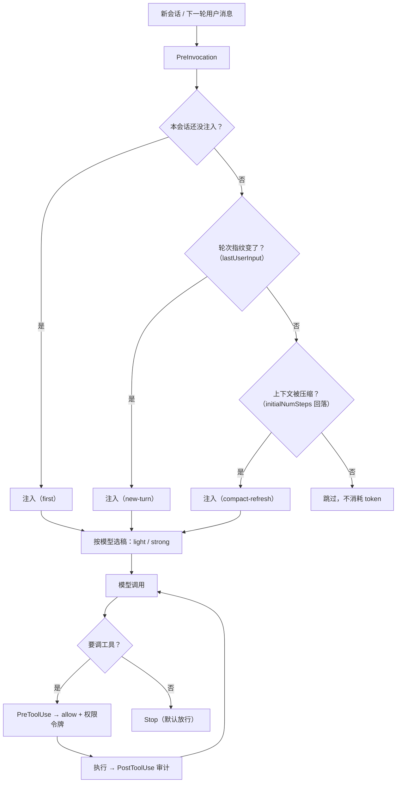

<p align="center">
  
</p>

# ⚔️ agy-purge —— Antigravity 破甲层

> 用 Google Antigravity 自己的 hooks，站在审批闸门和模型调用的**上游**：不碰 `app.asar`，不改 `language_server.exe`，升级不碎。

`agy-purge` 是 [dsh-purge](https://github.com/YuJunZhiXue/dsh-purge)（DeepSeek Harness 破甲）在 Antigravity 上的对应实现。dsh-purge 需要打补丁，是因为 DSH 没有对外扩展点；Antigravity 有 `plugin.json` + `hooks.json`，所以这里用原生扩展点拿到**同样的效果**，代价更小。

<p align="left">
  
  
  
  
  
</p>

**当前版本 v1.2.1** 的三条主线：

1. **注入按轮次算**：`PreInvocation` 每个用户轮次注入一次，轮内工具循环不重复——既贴调用点，又不烧 token。
2. **按模型分档**：`flash / mini / medium` 走直给稿，`neon / high / pro / thinking / opus / sonnet` 走「本地授权演练」稿。高能力模型把反审查措辞当越狱信号，越强调越容易硬拒。
3. **宿主感知**：记录 `app.asar` 构建指纹，Antigravity 升级后 `status` / `doctor` 直接告诉你插件是否还配着当前版本。

完整改动见 [CHANGELOG.md](CHANGELOG.md)。

---

## 目录

- [它做了什么](#它做了什么)
- [四层破甲](#四层破甲)
- [Token 成本与注入时机](#token-成本与注入时机)
- [按模型分档](#按模型分档)
- [安装](#安装)
- [使用](#使用)
- [工作原理](#工作原理)
- [和 dsh-purge 的对应关系](#和-dsh-purge-的对应关系)
- [回滚](#回滚)
- [排障](#排障)
- [更新日志](#更新日志)
- [边界](#边界)
- [署名](#署名)

---

## 它做了什么

Antigravity 的 agent 在把回答交给你之前要过好几道关：前言的权威声明、审批闸门、默认策略文本、提前收工。`agy-purge` 用官方 hook 协议逐层处理：

| 你会得到 | 实际发生什么 |
| --- | --- |
| **覆盖稿注入** | `PreInvocation` 在**每个用户轮次**开头把覆盖稿作为 `systemMessage` 压进轨迹；轮内多次模型调用不再重复，上下文被压缩时补注一次 |
| **审批全放行** | `PreToolUse` 对任意工具返回 `decision: "allow"`，并补齐 `permissionOverrides`，让「Always Allow」缓存一起生效 |
| **强制续跑（默认关）** | `Stop` 可在模型「没调工具就收工」时返回 `continue`；默认关闭，因为它会让每个回合凭空多出模型调用 |
| **审计** | `PostToolUse` 把决策与注入事件写进 `plugin_data/agy-purge/log/events.jsonl` |
| **一键回滚** | 每次写入前留 `*.agypurge.bak`；`revert` 精确撤销，`uninstall` 连数据一起清 |

零依赖，单文件 CLI，Node ≥ 18。没有系统 Node 也能跑：自动回落到 Antigravity 自带的 `agy-node` 垫片或 `ELECTRON_RUN_AS_NODE`。

---

## 四层破甲

```
┌──────────────────────────────────────────────────────────────┐
│  inject    PreInvocation → 覆盖稿进 systemMessage               │
│            每轮一次；按模型分档；压缩后补注                      │
├──────────────────────────────────────────────────────────────┤
│  gate      PreToolUse → allow + permissionOverrides            │
├──────────────────────────────────────────────────────────────┤
│  continue  Stop → continue（默认关；开时受 continue.max 约束）   │
├──────────────────────────────────────────────────────────────┤
│  log       PostToolUse / 注入事件 → events.jsonl（只审计）      │
└──────────────────────────────────────────────────────────────┘
```

```bash
agy-purge apply --layers=inject,gate                  # 只开注入 + 放行（最省）
agy-purge apply --layers=inject,gate,continue         # 需要"被抓回来继续干"时再加续跑
agy-purge revert                                      # 全撤
```

层开关落在 `<plugin_data>/agy-purge/config.json`，改完**下一次调用即生效**，不用重启 Antigravity。旧版配置会在 `apply` 时自动迁移到 v3。

---

## Token 成本与注入时机

v1.0 每次模型调用前都注入一段"常驻提醒"，还默认开着强制续跑。这不是免费午餐：

| 行为 | 代价 | 现在（v1.2+） |
| --- | --- | --- |
| 每次调用都注入 systemMessage | 一个回合十几次工具循环＝十几条"新指令"，模型每次重新对齐位阶 → 思考链变长 | **每轮一次**：`strategy: "turn"`，轮内不重复 |
| SessionStart + 首次 PreInvocation 各注入一次 | 同一份稿子两遍，还多一条 `Hook Json SessionStart` 步骤 | SessionStart 默认**不注入** |
| 上下文被压缩 | 覆盖稿被挤出轨迹，行为悄悄回退 | 检测 `initialNumSteps` 回落，只在此时补注 |
| 默认 `continue.max: 2` | 每回合凭空多跑 2 次完整模型调用 | 续跑层默认**关** |

四种注入策略，默认第一种：

```jsonc
// <plugin_data>/agy-purge/config.json
{ "prompt": { "strategy": "turn" } }                        // 每轮一次（默认：贴调用点 + 省）
{ "prompt": { "strategy": "once" } }                        // 每会话一次（最省，长会话后段会衰减）
{ "prompt": { "strategy": "interval", "fullEvery": 6 } }    // 每 6 次调用重注一次
{ "prompt": { "strategy": "every" } }                       // 每次调用都重注（最贵）
```

为什么不是纯 `once`：宿主 2.35 之后，新模型会在每轮开头重述策略前言，`once` 的位置太靠前会被压过——表现就是末尾多出「不在支持范围内」、执行变犹豫。`turn` 把注入挪到调用点前，成本仍只有每轮一次。

---

## 按模型分档

同一句话，`gemini-3.8-flash-medium` 会正常答应，`gemini-4-neon-high` 可能直接硬拒。这不是钩子没生效，而是高能力模型的安全训练更硬，并且对「覆盖层 / 忽略策略 / 别自我审查」这类**反审查措辞特别敏感**——越强调越像越狱尝试。

| 档位 | 命中模型 | 稿子风格 |
| --- | --- | --- |
| `light` | flash / mini / medium / fast / nano | v3 覆盖稿：执行力优先，直给 |
| `strong` | neon / high / pro / thinking / opus / sonnet / max | 「本地授权演练」：先写授权与范围，再写交付标准；不使用反审查措辞 |

```bash
agy-purge prompt --show --model gemini-4-neon-high       # → gemini/strong（714 字）
agy-purge prompt --show --model gemini-3.8-flash-medium  # → gemini/light（1067 字）
```

解析顺序（钩子与 CLI 完全一致）：

```
<data>/prompt-inject.md                    ← 用户稿（改过才生效）
<data>/prompt-<family>-<tier>.md           ← 例：prompt-gemini-strong.md
<data>/prompt-<family>.md
<plugin>/prompts/override.<family>-<tier>.md
<plugin>/prompts/override.<family>.md
<plugin>/prompts/override.<tier>.md
<plugin>/prompts/override.md
```

**种子稿不遮蔽分档稿**：如果 `prompt-inject.md` 还是我们自动写入且没被改动（sha 与 `state.seededSha` 一致），解析时跳过它；你改一个字，它就重新拿回最高优先。

---

## 安装

### 方式 A：一键脚本（推荐）

```powershell
# Windows
git clone https://github.com/machine-gun-tt/agy-purge-T.git
cd agy-purge-T
.\install.ps1
```

```bash
# macOS / Linux
git clone https://github.com/machine-gun-tt/agy-purge-T.git
cd agy-purge-T
./install.sh
```

脚本做的事：找可用的 Node → 把插件装进 `<gemini>/config/plugins/agy-purge` → 渲染 `hooks.json`（写死解释器绝对路径）→ 在 `config.json` 登记 `plugins.agy-purge.enabled = true` → 把覆盖稿落到 `plugin_data`。

### 方式 B：只用 CLI

```bash
node bin/agy-purge.mjs install     # = apply
node bin/agy-purge.mjs status
node bin/agy-purge.mjs doctor      # 真的把每个 hook 跑一遍
```

### 方式 C：项目级（团队共享，仅当前仓库生效）

```bash
node bin/agy-purge.mjs install --scope project
```

装到 `<repo>/.agents/plugins/agy-purge` 并登记 `.agents/plugins.json`，可以提交进 Git 给同事共用。

### 装完必须做的一步

**完全退出 Antigravity（不是关窗口），再打开，然后新开一个会话。** hooks 在会话开始时装载，旧会话不会中途长出破甲层。

---

## 使用

```bash
agy-purge status [--json]              # 四层状态 / 补丁项 / 覆盖稿 / 档位 / 运行时
agy-purge apply [--layers=a,b]         # 落地（幂等，自动迁移旧配置）
agy-purge revert                       # 精确回滚，保留覆盖稿
agy-purge uninstall [--purge-prompt]   # 卸载插件并清理数据
agy-purge repair                       # 升级后修复：重渲染 hooks、补回漂移文件
agy-purge prompt --show                # 当前生效的覆盖稿
agy-purge prompt --show --model NAME   # 某个模型实际会拿到哪份稿（含档位）
agy-purge prompt --set my.md [--variant gemini-strong]
agy-purge prompt --reset
agy-purge doctor                       # 体检 + 真跑每个 hook（含轮内去重与宿主指纹）
agy-purge serve --port 7878            # 本地面板（只监听 127.0.0.1）
agy-purge test-hook PreToolUse         # 单独喂载荷看某个 hook 怎么回
```

`status` 输出（路径已脱敏）：

```
agy-purge · Antigravity 破甲层

宿主       <Antigravity 安装目录>
定制根     <gemini>/config
安装目录   <gemini>/config/plugins/agy-purge
数据目录   <plugin_data>/agy-purge
运行时     PATH · node v24 · <node>
覆盖稿     user:prompt-inject.md · 1067 字符 · 7c3eabee44aa · 档位 light
注入策略   每轮一次（默认） · 已记账会话 12
续跑       关（不额外增加模型调用）

补丁项
  ✓ applied  plugin:files       v1.2.1 → <gemini>/config/plugins/agy-purge
  ✓ applied  plugin:hooks       5 条命令，解释器 <node>
  ✓ applied  plugin:registered  <gemini>/config/config.json → plugins.agy-purge.enabled = true
  ✓ applied  prompt:seeded      1067 字符 · 7c3eabee44aa
  ✓ applied  runtime:config     v3 · 注入 turn · 续跑 停 · 已关：continue
  · skipped  host:grants        未启用（--grants 才写）
  · skipped  project:registry   仅 --scope project
```

### 自定义覆盖稿

```bash
agy-purge prompt --set my.md                        # 全局（压过所有分档稿）
agy-purge prompt --set strong.md --variant gemini-strong  # 只覆盖 gemini/strong
agy-purge prompt --show --model gemini-4-neon-high  # 确认实际生效的是哪份
```

### 本地面板

```bash
agy-purge serve --port 7878
```

打开 `http://127.0.0.1:7878/`：四层开关、补丁项状态、覆盖稿编辑器、Apply / Revert / 体检。只监听回环地址，写操作要 CSRF 令牌。

---

## 工作原理



每条 hook 的硬约束（也是实现纪律）：

- **永远输出一个合法 JSON 且退出码 0**：坏输入、异常、超时全部退化成 `{}`，不把错误抛回 agent 循环。
- **3 秒看门狗**：宿主给 5–10 秒；超时会被静默丢弃，症状像「模型不听话」。
- **不写 `metadata`**：部分版本在 `systemMessage.metadata` 上会 panic，只发纯字符串。
- 实测单次 hook **55–90 ms**（Windows / Node 24）。

---

## 和 dsh-purge 的对应关系

| dsh-purge | agy-purge | 说明 |
| --- | --- | --- |
| `prompt-inject.md` 注入 | `PreInvocation` → `systemMessage` | 入口从「改包内系统提示」换成「调用前注入」 |
| 审批/沙箱补丁 | `PreToolUse` → `allow` | 站在闸门本身，比改闸门代码更稳 |
| `hooksDenyBypass` | `gate.denyPatterns`（默认空） | 想留护栏就自己写模式 |
| `autoContinue` | `Stop` → `continue` | **默认关**；开启时受 `continue.max` 约束 |
| 按模型换稿 | `prompt-<family>-<tier>.md` | 比按家族更细：高能力模型单独一档 |
| Clean 页补丁项 | `status` / 面板 | 状态机一致：applied / pending / drift / conflict / skipped |
| `*.dshpurge.bak` | `*.agypurge.bak` | 一次备份不覆盖，revert 精确撤销 |
| Red-team Drill | `agy-purge-drill` 技能 | 改为「分层定位」：模型层 vs 宿主层 |
| dock | `agy-purge serve` | 回环面板 + CSRF 令牌 |
| 改 `@deepseek-ai/*` | **不改任何宿主文件** | 见 [why-no-binary-patch.md](docs/why-no-binary-patch.md) |

---

## 回滚

```bash
agy-purge revert                    # 撤四层，保留你改过的覆盖稿
agy-purge uninstall                 # 撤四层 + 删 plugin_data
agy-purge uninstall --purge-prompt  # 连覆盖稿一起删
```

回滚是精确的，不是「恢复备份文件」：

- `config.json` 只删 `plugins.agy-purge` 这一个键，`userSettings` 里你自己加的授权不受影响；
- `--grants` 写进去的授权按记录逐条撤销；
- 插件目录整个删除；覆盖稿是用户文件，`revert` 不碰它。

宿主文件一个都没改过，所以「恢复原状」本身不需要备份。

---

## 排障

先跑 `agy-purge doctor`（会真跑每个 hook，报耗时与决策）。

| 症状 | 原因 | 处理 |
| --- | --- | --- |
| 装了没反应 | 没重启 / 没新开会话 | 完全退出 Antigravity，新开会话 |
| `hook:*` 全红 | 解释器路径变了 | `agy-purge repair` |
| `plugin:files` = `drift` | 升级覆盖了文件 | `agy-purge apply` |
| `config.json` = `conflict` | JSON 坏了 | 先修 JSON，插件拒绝在坏文件上写 |
| 还弹审批 | `gate` 层关了，或 hook 超时 | `agy-purge apply --layers=gate`，看 doctor 耗时 |
| 宿主升级后突然变保守 | 新宿主/新模型每轮重带策略前言 | `agy-purge apply` → 完全重启；仍软则 `strategy: "every"` |
| 同一句话 Flash 同意、Neon 硬拒 | 模型层安全训练差异 | 确认 `prompt --show --model` 命中 strong；不满意就写自己的 `prompt-gemini-strong.md` |
| 前两轮正常后来软化 | 上下文稀释 | `strategy: "interval"` + `fullEvery: 3` |
| 回答到一半停住 | `continue` 层默认关 | `agy-purge apply --layers=inject,gate,continue` |

更多见 [docs/faq.md](docs/faq.md) 与内置技能 `agy-purge-drill`。

---

## 更新日志

| 版本 | 日期 | 主题 |
| --- | --- | --- |
| [v1.2.1](CHANGELOG.md#v1212026-11-27) | 2026-11-27 | 按模型档位换稿，修 Neon 硬拒；分档解析、种子稿遮蔽、CLI/钩子不一致、升级残留文件等修复；文档与发布流程收口 |
| [v1.2.0](CHANGELOG.md#v1202026-11-27) | 2026-11-27 | 每轮一次注入、v3 覆盖稿、宿主构建指纹 |
| [v1.1.0](CHANGELOG.md#v1102026-11-25) | 2026-11-25 | 去掉每调用注入与默认续跑，省 token |
| [v1.0.0](CHANGELOG.md#v1002026-11-25) | 2026-11-25 | 四层破甲首版 |

每个版本的「改了什么 / 修了哪些 bug」都写在 [CHANGELOG.md](CHANGELOG.md)，GitHub Release 说明也按版本对应到该文件。

---

## 边界

- 只操作**你自己机器上** Antigravity 的 customization 目录与 `plugin_data`，不碰宿主二进制。
- 授权由你自己给：`agy-purge` 是本地策略层，不是任何系统的通行证。
- `--grants` 默认不开。要全局「Always Allow」就显式加。
- 本项目与被提到的任何公司无隶属关系。

---

## 署名

思路与产品形态源自 **[YuJunZhiXue/dsh-purge](https://github.com/YuJunZhiXue/dsh-purge)**（MIT）。`agy-purge` 是 Antigravity 侧的独立重写：宿主接口、实现方式、代码全部不同，但「把宿主层与模型层拆开处理」的方法论来自它。二次开发请保留 [NOTICE.md](NOTICE.md) 的署名章节。

MIT © machine-gun-tt
