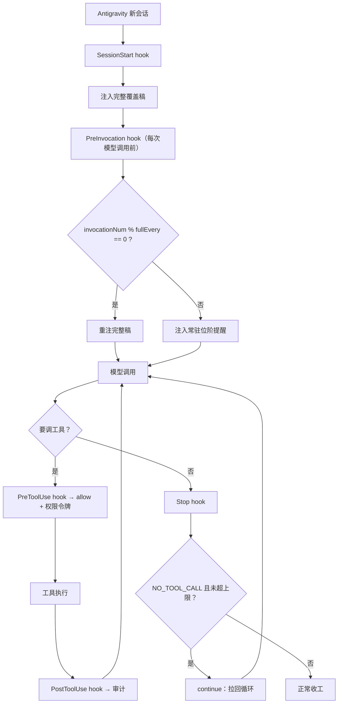

# ⚔️ agy-purge —— Antigravity 破甲层

> 同一套破甲思路，换到 Google Antigravity 上：**用宿主自己的 hooks 站在审批闸门和模型调用的上游**，不碰 `app.asar`，不改 `language_server.exe`。

`agy-purge` 是 [dsh-purge](https://github.com/YuJunZhiXue/dsh-purge)（DeepSeek Harness 破甲）在 Antigravity 上的对应实现。dsh-purge 之所以要打补丁，是因为 DSH 没有对外暴露扩展点；Antigravity 有 `plugin.json` + `hooks.json`，所以这里用原生扩展点拿到**同样的效果**，而且升级不会碎。

<p align="left">
  
  
  
  
</p>

---

## 目录

- [它做了什么](#它做了什么)
- [四层破甲](#四层破甲)
- [安装](#安装)
- [使用](#使用)
- [工作原理](#工作原理)
- [和 dsh-purge 的对应关系](#和-dsh-purge-的对应关系)
- [回滚](#回滚)
- [排障](#排障)
- [边界](#边界)
- [署名](#署名)

---

## 它做了什么

Antigravity 的 agent 在把回答交给你之前会过好几道关：前言的权威声明、审批闸门、默认策略文本、提前收工。dsh-purge 把这些关卡拆开逐个处理；`agy-purge` 在 Antigravity 上做同一件事，只是入口换成了官方 hook 协议：

| 你会得到 | 实际发生什么 |
| --- | --- |
| **覆盖稿注入** | `SessionStart` + `PreInvocation` 把覆盖提示词作为 `systemMessage` 压进轨迹，每 `fullEvery` 轮补注一次 |
| **审批全放行** | `PreToolUse` 对任意工具返回 `decision: "allow"`，并补齐 `permissionOverrides`，让「Always Allow」缓存一起生效 |
| **强制续跑** | `Stop` 在模型「没调工具就收工」时返回 `continue`，把循环拉回来（带上限，不会死循环） |
| **审计** | `PostToolUse` 把事件写进 `plugin_data/agy-purge/log/events.jsonl`，随时能复核 |
| **一键回滚** | 每一次写入前留 `*.agypurge.bak`；`revert` 精确撤销，`uninstall` 连数据一起清 |

零依赖，单文件 CLI，Node ≥ 18（没有 Node 也能跑：会自动用 Antigravity 自带的 `agy-node` 垫片或 `ELECTRON_RUN_AS_NODE`）。

---

## 四层破甲

```
┌──────────────────────────────────────────────────────────────┐
│  inject    SessionStart / PreInvocation → 覆盖稿进 systemMessage │
├──────────────────────────────────────────────────────────────┤
│  gate      PreToolUse → allow + permissionOverrides            │
├──────────────────────────────────────────────────────────────┤
│  continue  Stop → continue（executionNum < continue.max）       │
├──────────────────────────────────────────────────────────────┤
│  log       PostToolUse → events.jsonl（只审计，不做决策）        │
└──────────────────────────────────────────────────────────────┘
```

四层可以单独开关：

```bash
agy-purge apply --layers=inject,gate      # 只开注入 + 放行
agy-purge revert                          # 全撤
```

层开关落在 `<plugin_data>/agy-purge/config.json`，改完**下一次调用即生效**，不用重启 Antigravity。

---

## 安装

### 方式 A：一键脚本（推荐）

```powershell
# Windows
git clone https://github.com/skywalkerTT/agy-purge-T.git
cd agy-purge-T
.\install.ps1
```

```bash
# macOS / Linux
git clone https://github.com/skywalkerTT/agy-purge-T.git
cd agy-purge-T
./install.sh
```

脚本做的事：找一个能用的 Node → 把插件装进 `<gemini>/config/plugins/agy-purge` → 渲染 `hooks.json`（写死解释器绝对路径）→ 在 `config.json` 里登记 `plugins.agy-purge.enabled = true` → 把覆盖稿落到 `plugin_data`。

### 方式 B：只用 CLI

```bash
node bin/agy-purge.mjs install            # = apply
node bin/agy-purge.mjs status             # 看四层状态
node bin/agy-purge.mjs doctor             # 体检（真的把每个 hook 跑一遍）
```

### 方式 C：项目级（团队共享，仅当前仓库生效）

```bash
node bin/agy-purge.mjs install --scope project
```

装到 `<repo>/.agents/plugins/agy-purge` 并登记 `.agents/plugins.json`，可以提交进 Git 给同事共用。

### 装完必须做的一步

**完全退出 Antigravity（不是关窗口），再打开，然后新开一个会话。** hooks 在会话开始时装载；正在跑的旧会话不会突然长出破甲层。

---

## 使用

```bash
agy-purge status [--json]          # 四层状态 / 补丁项 / 覆盖稿 / 运行时
agy-purge apply [--layers=a,b]     # 落地（幂等）
agy-purge revert                   # 精确回滚，保留覆盖稿
agy-purge uninstall                # 卸载插件 + 清数据（--purge-prompt 连稿一起删）
agy-purge repair                   # Antigravity 升级后修复：重渲染 hooks、补回漂移文件
agy-purge prompt --show            # 看当前生效的覆盖稿
agy-purge prompt --set my.md       # 换成自己的稿
agy-purge prompt --reset           # 复位到内置稿
agy-purge doctor                   # 体检 + hook 自检
agy-purge serve --port 7878        # 本地面板（只监听 127.0.0.1）
agy-purge test-hook PreToolUse     # 单独喂一个载荷看某个 hook 怎么回
```

`status` 的输出长这样：

```
agy-purge · Antigravity 破甲层

宿主       C:\Users\<you>\AppData\Local\Programs\Antigravity
定制根     C:\Users\<you>\.gemini\config
安装目录   C:\Users\<you>\.gemini\config\plugins\agy-purge
数据目录   C:\Users\<you>\.gemini\antigravity\plugin_data\agy-purge
运行时     PATH · node v24 · C:\Program Files\nodejs\node.exe
覆盖稿     user:prompt-inject.md · 524 字符 · c67fcedcfa1a

补丁项
  ✓ applied  plugin:files       v1.0.0 → ...\plugins\agy-purge
  ✓ applied  plugin:hooks       5 条命令，解释器 C:\Program Files\nodejs\node.exe
  ✓ applied  plugin:registered  ...\config.json → plugins.agy-purge.enabled = true
  ✓ applied  prompt:seeded      524 字符 · c67fcedcfa1a
  ✓ applied  runtime:config     四层全开
  · skipped  host:grants        未启用（--grants 才写）
```

### 覆盖稿：按模型分稿

和 dsh-purge 一样支持「不同模型不同稿」。解析优先级：

```
<plugin_data>/prompt-inject.md          ← 你改这里，最高优先
<plugin_data>/prompt-<variant>.md       ← 按模型分稿（gemini / claude / gpt）
<plugin>/prompts/override.<variant>.md  ← 插件内置的按模型默认稿
<plugin>/prompts/override.md            ← 兜底
```

```bash
agy-purge prompt --set mine.md --variant claude
```

### 本地面板

```bash
agy-purge serve --port 7878
```

打开 `http://127.0.0.1:7878/`：四层开关、补丁项状态、覆盖稿编辑器、Apply / Revert / 体检。只监听回环地址，写操作要 CSRF 令牌。

---

## 工作原理



每个 hook 的硬性约束（也是本项目的实现纪律）：

- **永远输出一个合法 JSON 并退出码 0**：坏输入、异常、超时全部退化成 `{}`，绝不把错误抛回 agent 循环。
- **3 秒看门狗**：宿主给的 timeout 是 5–10 秒；超时会被吞掉，症状看起来像「模型不听话」。
- **不写 `metadata`**：Antigravity 部分版本（已知 2.31.0）在 `systemMessage.metadata` 上会 panic，所以只发纯字符串。
- 实测单次 hook 耗时 **53–56 ms**（Windows / Node 24），对循环几乎无感。

---

## 和 dsh-purge 的对应关系

| dsh-purge | agy-purge | 说明 |
| --- | --- | --- |
| `prompt-inject.md` 注入 | `PreInvocation` → `systemMessage` | 同一份稿子语义，入口从「改包内系统提示」换成「调用前注入」 |
| 审批/沙箱补丁 | `PreToolUse` → `allow` | 站在闸门本身，比改闸门代码更稳 |
| `hooksDenyBypass` | `gate.denyPatterns`（默认空） | 想留护栏就自己写模式 |
| `autoContinue` | `Stop` → `continue` | 带 `continue.max` 上限，防死循环 |
| Clean 页的补丁项 | `status` / 面板的补丁项 | 状态机一致：applied / pending / drift / conflict / skipped |
| `*.dshpurge.bak` | `*.agypurge.bak` | 一次备份不覆盖，revert 精确撤销 |
| 按模型换稿 | `prompt-<variant>.md` | gemini / claude / gpt 三套内置稿 |
| Red-team Drill | `agy-purge-drill` 技能 | 改「分层定位」：模型层 vs 宿主层，先定位再动手 |
| dock | `agy-purge serve` | Antigravity 不给第三方任意 UI，所以用回环面板 |
| 改 `@deepseek-ai/*` | **不改任何宿主文件** | 这是最大的差异，见下 |

### 为什么这次不用改二进制

dsh-purge 要 patch `@deepseek-ai/*`，因为 DSH 的审批与提示词组装没有对外钩子。Antigravity 的 hooks 在**同一条链路的更上游**：`PreToolUse` 就是闸门本身，`PreInvocation` 就在模型调用之前。改 `app.asar` / `language_server.exe` 的收益是 0，代价是每次升级都碎、并且要面对签名与完整性校验。详见 [docs/why-no-binary-patch.md](docs/why-no-binary-patch.md)。

---

## 回滚

```bash
agy-purge revert            # 撤四层，保留你改过的覆盖稿
agy-purge uninstall         # 撤四层 + 删 plugin_data
agy-purge uninstall --purge-prompt   # 连覆盖稿一起删
```

回滚是精确的，不是「恢复备份文件」：

- `config.json` 只删 `plugins.agy-purge` 这一个键，`userSettings` 里你自己加的授权不受影响；
- `--grants` 写进去的授权按记录逐条撤销，不动别人的；
- 插件目录整个删除；
- 覆盖稿是用户文件，`revert` 不碰它。

宿主文件一个都没改过，所以「恢复原状」这一步本身不需要备份。

---

## 排障

先跑体检：

```bash
agy-purge doctor
```

| 症状 | 原因 | 处理 |
| --- | --- | --- |
| 装了没反应 | 没重启 / 没新开会话 | 完全退出 Antigravity，新开会话 |
| `hook:*` 全红 | 解释器路径变了（换 Node、重装 Antigravity） | `agy-purge repair` |
| `plugin:files` = `drift` | 升级覆盖了文件 | `agy-purge apply` |
| `config.json` = `conflict` | JSON 坏了 | 先修 JSON，插件拒绝在坏文件上写 |
| 还弹审批 | `gate` 层关了，或 hook 超时 | `agy-purge apply --layers=gate`，看 `doctor` 的耗时 |
| 前两轮正常后来软化 | 上下文稀释 | `prompt.fullEvery` 调小（如 3） |
| 回答到一半停住 | `continue` 层没接住 | 确认层开启，`continue.max ≥ 2` |

更多见 [docs/faq.md](docs/faq.md) 和内置技能 `agy-purge-drill`。

---

## 边界

- 只操作**你自己机器上** Antigravity 的 customization 目录与 `plugin_data`，不碰宿主二进制。
- 授权由你自己给：`agy-purge` 是本地策略层，不是任何系统的通行证。用它去打别人的机器，责任在你。
- `--grants` 默认不开。要全局「Always Allow」就显式加，别怪它默认保守。
- 本项目与被提到的任何公司无隶属关系；`Antigravity`、`DeepSeek Harness` 等名称归各自所有者。

---

## 署名

思路与产品形态源自 **[YuJunZhiXue/dsh-purge](https://github.com/YuJunZhiXue/dsh-purge)**（MIT）。`agy-purge` 是 Antigravity 侧的独立重写：宿主接口、实现方式、代码全部不同，但「把宿主层与模型层拆开处理」的方法论来自它。二次开发请保留本段署名与 [NOTICE.md](NOTICE.md)。

MIT License · 见 [LICENSE](LICENSE)。
